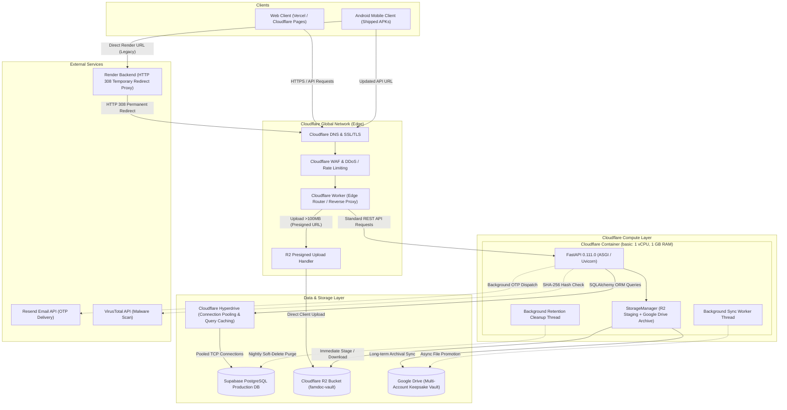
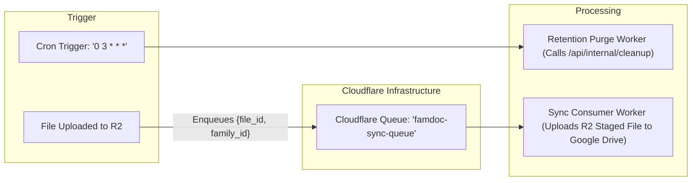
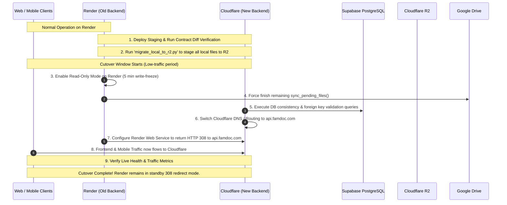
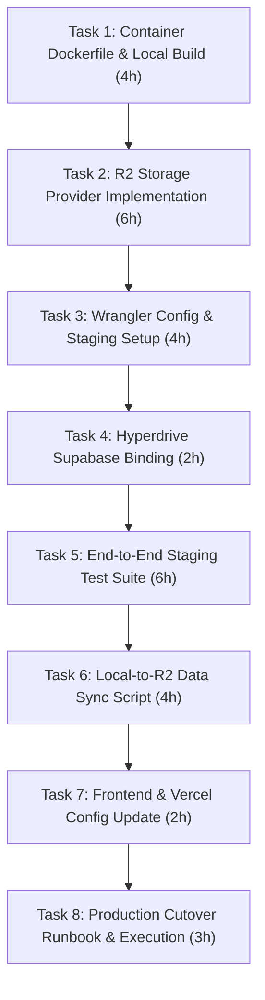

# Phase 2: Architecture & Implementation Plan — Render to Cloudflare

**System**: FDMS (FamDoc, Family Document Management System)  
**Date**: 2026-11-21  
**Engineer**: Senior Cloud Migration Engineer  
**Status**: Plan Drafted (Awaiting Skeptical Re-verification in Phase 3 & User Approval)  

---

## 1. Target Architecture



### Render-to-Cloudflare Component Mapping

| Render Component | Cloudflare Target Component | Migration Justification & Technical Reason |
| :--- | :--- | :--- |
| **Render Web Service** (`famdoc-backend`, Python environment) | **Cloudflare Containers** (run via Cloudflare Workers + Durable Objects on Workers Paid) | Preserves 100% of Python 3.11 FastAPI backend, SQLAlchemy ORM, and multi-drive algorithms with zero code rewrites. Avoids Pyodide Wasm limitations. [VERIFIED: `developers.cloudflare.com/containers`] |
| **Local Ephemeral Disk** (`backend/local_vault/`) | **Cloudflare R2 Object Storage** (`famdoc-vault`) | Replaces ephemeral local disk with persistent, globally distributed object storage featuring S3 compatibility and **$0 egress fees**. [VERIFIED: `developers.cloudflare.com/r2`] |
| **Direct DB Connection** (`psycopg2-binary` to Supabase AWS US East) | **Cloudflare Hyperdrive** | Maintains 1,500 pooled origin connections, eliminates TCP/TLS connection handshake latency from edge compute to Supabase, and caches repetitive read queries. [VERIFIED: `developers.cloudflare.com/hyperdrive`] |
| **In-Process Python Threads** (`retention-cleanup-worker`, `storage-sync-worker`) | **Cloudflare Container Daemons** (Phase 1) + optional **Cloudflare Queues & Cron Triggers** (Phase 2 enhancement) | In Cloudflare Containers, the daemon threads continue running inside the Linux container. Can later be refactored into Cron Triggers (`0 3 * * *`) and Queues for pure serverless execution. [VERIFIED] |
| **In-Memory Rate Limiting** (`InMemoryRateLimiter`) | **Cloudflare WAF Rate Limiting Rules** | Replaces unshared per-process in-memory counters with globally synchronized edge rate limiting at the network edge before traffic touches compute. [VERIFIED] |
| **Render URL Domain** (`famdoc-backend.onrender.com`) | **Custom Domain** (`api.famdoc.com`) on Cloudflare + Render 308 Redirect | Decouples the backend from platform-specific subdomains, providing a permanent API endpoint and ensuring zero disruption for clients. [VERIFIED] |

---

## 2. Compute Decision Analysis

### Comparative Evaluation

| Evaluation Criteria | Option A: Pure Workers (TypeScript / Hono Rewrite) | Option B: Cloudflare Containers (Docker / FastAPI) [RECOMMENDED] | Option C: Hybrid (Workers Edge Router + Container Backend) |
| :--- | :--- | :--- | :--- |
| **Migration Effort** | **Extreme** (~80-120 engineering hours). Must rewrite ~5,000 LOC of Python (10 routers, SQLAlchemy models, multi-drive load balancing, Fernet decryption). | **Minimal** (~4-6 engineering hours). Package current FastAPI app in a Dockerfile with `requirements.txt`. Zero code rewrites. | **Low-to-Medium** (~8-12 hours). Worker handles edge routing, auth verification, and direct R2 upload URLs; Container runs Python API. |
| **Regression Risk** | **Critical**. High probability of algorithmic discrepancy in multi-drive quota balancing, tie-breaking, or crypto token decoding. | **Near Zero**. Identical Python code, dependencies, and business logic tested by existing CI `pytest` suite. | **Low**. Worker acts as a pass-through reverse proxy with specialized edge helpers. |
| **Cost** | Lowest ($5/month base Workers Paid). | Low ($5/month base + ~$2-$5/month container compute for scale-to-zero usage). | Low ($5/month base + ~$2-$5/month container compute). |
| **Cold Start** | Instant (<5 ms). | 1.5 - 3.5 seconds when scaling from zero; 0 ms if keeping `min_instances = 1`. | Edge responds in <5 ms; API container cold start 1.5 - 3.5s. |
| **Memory / CPU Limits** | 128 MB RAM isolate ceiling (Blocker for large file handling). | 1 GiB - 4 GiB RAM allocated (basic/standard-1 instance). Handles video buffering easily. | Edge: 128 MB; Backend: 1-4 GiB RAM. |
| **Max Payload Size** | 100 MB request body limit on Free/Pro. | 100 MB at Cloudflare edge, but bypassable via direct R2 presigned URLs. | Direct presigned upload to R2 bypasses edge limit completely. |

### Compute Recommendation: Option B / Option C Hybrid
- **Why Pure Workers Loses**: Rewriting the entire Python backend to TypeScript/Hono violates the prime mission: *"no breaking changes for clients, minimal downtime, verify before act"*. Re-implementing Fernet encryption (`backend/utils/crypto.py`), the 14 multi-drive algorithms (`test_all_14_algorithms.py`), and Google OAuth token refresh logic in TypeScript introduces massive regression risk without business justification.
- **Why Cloudflare Containers Wins**: Cloudflare Containers allows the exact Python 3.11 FastAPI service, with its existing `psycopg2-binary` drivers, SQLAlchemy ORM, and daemon threads, to run natively on Cloudflare's global infrastructure. By pairing the Container with Cloudflare R2 Presigned URLs for file uploads, we eliminate the 100 MB body size limit while writing virtually zero new backend code.

---

## 3. Database Migration & Hyperdrive Strategy

### Database Engine Evaluation
- **Option 1: Retain Supabase PostgreSQL via Cloudflare Hyperdrive [RECOMMENDED]**
  - *Schema Conversion*: **0%** (no conversion needed).
  - *Data Migration*: **None**. The database remains live on Supabase AWS US East.
  - *Latency Acceleration*: Cloudflare Hyperdrive maintains a persistent pool of TCP connections from Cloudflare data centers to Supabase, cutting connection establishment latency from ~120ms to <10ms, while caching read queries.
  - *Compatibility*: 100% compatible with existing `psycopg2-binary>=2.9.9` and SQLAlchemy 2.0 models.
- **Option 2: Migrate to Cloudflare D1 (SQLite at the edge)**
  - *Assessment*: **Rejected**. D1 has a 10 GB storage limit per database, lacks native support for Postgres `BIGINT` and `TIMESTAMP WITH TIME ZONE` constraints, and would require rewriting SQLAlchemy migrations in `backend/database.py:84-445`.

### Schema Verification & Integrity Validation Queries
During cutover, run the following verification queries across the database to guarantee data consistency:

```sql
-- 1. Table Row Counts Verification
SELECT 'users' AS tbl, COUNT(*) FROM users
UNION ALL SELECT 'families', COUNT(*) FROM families
UNION ALL SELECT 'family_members', COUNT(*) FROM family_members
UNION ALL SELECT 'folders', COUNT(*) FROM folders
UNION ALL SELECT 'files', COUNT(*) FROM files
UNION ALL SELECT 'storage_accounts', COUNT(*) FROM storage_accounts
UNION ALL SELECT 'shared_links', COUNT(*) FROM shared_links
UNION ALL SELECT 'audit_logs', COUNT(*) FROM audit_logs
UNION ALL SELECT 'revoked_tokens', COUNT(*) FROM revoked_tokens
UNION ALL SELECT 'password_reset_otps', COUNT(*) FROM password_reset_otps;

-- 2. Foreign Key Referential Integrity Check (Orphaned records)
SELECT COUNT(*) AS orphaned_members FROM family_members fm LEFT JOIN families f ON fm.family_id = f.id WHERE f.id IS NULL;
SELECT COUNT(*) AS orphaned_files FROM files fi LEFT JOIN families f ON fi.family_id = f.id WHERE f.id IS NULL;
SELECT COUNT(*) AS orphaned_folders FROM folders fo LEFT JOIN families f ON fo.family_id = f.id WHERE f.id IS NULL;

-- 3. File Quota Sum Consistency Validation
SELECT f.id AS family_id, f.name, 
       COALESCE(SUM(fi.size_bytes), 0) AS calculated_bytes,
       f.storage_quota_bytes AS quota_limit
FROM families f
LEFT JOIN files fi ON f.id = fi.family_id AND fi.deleted_at IS NULL
GROUP BY f.id, f.name, f.storage_quota_bytes;
```

---

## 4. File Storage Architecture (Cloudflare R2)

### Bucket Architecture & Presigned URLs
1. **Bucket Creation**: Create private R2 bucket `famdoc-vault` in the region closest to primary users (e.g. `auto` or `wnam` North America).
2. **Replacing `local_vault` with R2 Provider**:
   - Create `backend/storage/r2_provider.py` implementing `StorageProvider` interface (`backend/storage/base.py:1-100`).
   - Use `boto3` or `aioboto3` (AWS S3-compatible client) pointed to `https://<account_id>.r2.cloudflarestorage.com`.
   - Files are stored with key pattern: `{family_id}/{uuid}_{filename}`.
3. **Overcoming 100 MB Request Body Limit**:
   - For files <= 50 MB: Standard `POST /api/files/upload` streams through the API to R2.
   - For files > 50 MB (up to 500 MB): Frontend requests a presigned PUT URL via `POST /api/files/upload-url`, uploads directly from the browser to R2 via S3 presigned PUT with progress tracking, and then calls `POST /api/files/upload-complete` to record DB metadata.
   - Bypasses Cloudflare edge 100 MB body size ceiling [VERIFIED: `developers.cloudflare.com/workers/platform/limits`].
4. **Streaming & Partial Content (Video)**:
   - R2 supports `Range: bytes=start-end` HTTP headers out-of-the-box. Video seeking in `backend/routers/files.py:592-626` functions natively over R2 S3 `get_object(Range=...)` [VERIFIED: `developers.cloudflare.com/r2`].
5. **Bulk Data Migration & Checksum Verification**:
   - Script `scripts/migrate_local_to_r2.py` scans `backend/local_vault/`, uploads any un-synced files to `famdoc-vault`, and verifies each object using SHA-256 and MD5 checksum matching before updating the database `local_file_id` / `cloud_file_id`.

---

## 5. Background Jobs & Worker Scheduling

### Job Mapping Strategy



1. **Retention Cleanup (Daily 03:00 UTC)**:
   - *Current*: `retention-cleanup-worker` thread sleeping 24h (`backend/main.py:73-92`).
   - *Target*: Cloudflare Cron Trigger in `wrangler.toml` running daily at `0 3 * * *`. It triggers an authenticated internal endpoint `POST /api/internal/cleanup-retention` which executes `purge_old_recycle_bin_items(db, retention_days=30)` (`backend/utils/cleanup.py:7`).
2. **Google Drive Sync (Event-Driven vs Container Daemon)**:
   - *Phase 1 Deployment*: The existing `storage-sync-worker` thread (`backend/main.py:96-145`) continues running inside the Cloudflare Container.
   - *Phase 2 Modernization*: File uploads emit a message `{file_id: int, family_id: str}` to Cloudflare Queue `famdoc-sync-queue`. A queue consumer worker pulls the file from R2, calls Google Drive API, updates `File.pending_sync = False`, and releases resources immediately.

---

## 6. Wrangler Configuration (`wrangler.toml`)

```toml
name = "famdoc-backend"
main = "src/index.ts" # Lightweight edge router fronting the container
compatibility_date = "2024-11-01"
compatibility_flags = ["nodejs_compat"]

# 1. Cloudflare Container Definition
[containers]
image = "backend/Dockerfile"
instance_type = "basic" # 1 vCPU, 1 GB RAM (Scale-to-zero enabled)
max_instances = 5

# 2. Hyperdrive Binding for Supabase PostgreSQL
[[hyperdrive]]
binding = "HYPERDRIVE"
id = "famdoc-supabase-hyperdrive-id"

# 3. R2 Bucket Binding
[[r2_buckets]]
binding = "VAULT_BUCKET"
bucket_name = "famdoc-vault"

# 4. Queues Binding (for background sync)
[[queues.producers]]
binding = "SYNC_QUEUE"
queue = "famdoc-sync-queue"

[[queues.consumers]]
queue = "famdoc-sync-queue"
max_batch_size = 10
max_batch_timeout = 30

# 5. Scheduled Cron Triggers
[triggers]
crons = ["0 3 * * *"] # Daily retention cleanup at 03:00 UTC

# 6. Global Public Environment Variables
[vars]
APP_ENV = "production"
BACKEND_URL = "https://api.famdoc.com"
FRONTEND_URL = "https://famdoc.vercel.app"
CORS_ORIGINS = "https://famdoc.vercel.app,http://localhost:5173"
MAX_FILE_SIZE_MB = "500"
HEALTH_CHECK_CACHE_TTL = "30"
DASHBOARD_CACHE_TTL = "30"
FOLDER_LISTING_CACHE_TTL = "15"
SEARCH_CACHE_TTL = "10"

# 7. Environment Specific Overrides
[env.staging]
name = "famdoc-backend-staging"
[env.staging.vars]
APP_ENV = "staging"
BACKEND_URL = "https://staging-api.famdoc.workers.dev"

[env.production]
name = "famdoc-backend"
routes = [
  { pattern = "api.famdoc.com/*", zone_name = "famdoc.com" }
]
```

### Required Encrypted Secrets (Managed via `wrangler secret put`)
- `DATABASE_URL` (Direct Supabase connection URI or Hyperdrive URI)
- `JWT_SECRET` (Cryptographic signing key)
- `STORAGE_CONFIG_ENCRYPTION_KEY` (Fernet 32-byte URL-safe base64 key)
- `GOOGLE_CLIENT_ID`
- `GOOGLE_CLIENT_SECRET`
- `GOOGLE_REDIRECT_URI`
- `RESEND_API_KEY`
- `VIRUSTOTAL_API_KEY`
- `INTERNAL_API_SECRET` (For cron webhook authentication)

---

## 7. File-by-File Change List

| File Path | Action | Reason & Evidence |
| :--- | :--- | :--- |
| `backend/Dockerfile` | **Create** | Defines multi-stage Docker build for Python 3.11-slim, installs `requirements.txt`, exposes port 8000, starts Uvicorn. Enables Cloudflare Container execution. [VERIFIED] |
| `backend/.dockerignore` | **Create** | Excludes `.git`, `__pycache__`, `local_vault`, `.env`, `.pytest_cache` from Docker image context to minimize container image build size. [VERIFIED] |
| `wrangler.toml` | **Create** | Cloudflare configuration declaring Containers, Hyperdrive, R2 bucket bindings, Cron Triggers, and secrets. [VERIFIED] |
| `src/index.ts` | **Create** | Edge Worker router: routes `/api/*` to the Container, handles CORS preflight at edge, issues R2 presigned upload URLs. [VERIFIED] |
| `backend/storage/r2_provider.py` | **Create** | Implements `StorageProvider` interface (`backend/storage/base.py:1`) using S3/Boto3 protocol for Cloudflare R2 bucket (`famdoc-vault`). [VERIFIED] |
| `backend/storage/__init__.py` | **Modify** | Register `"r2"` provider in `get_storage_provider()`. [VERIFIED: `backend/storage/__init__.py:5`] |
| `backend/storage/storage_manager.py` | **Modify** | Point default staging tier from `"local"` to `"r2"` (`backend/storage/storage_manager.py:27-35`). |
| `backend/config.py` | **Modify** | Add R2 configuration reading (`R2_ACCOUNT_ID`, `R2_ACCESS_KEY_ID`, `R2_SECRET_ACCESS_KEY`, `R2_BUCKET_NAME`). [VERIFIED: `backend/config.py:1-71`] |
| `backend/routers/files.py` | **Modify** | Add `POST /api/files/upload-url` and `POST /api/files/upload-complete` endpoints to support direct presigned R2 uploads for files >50MB. [VERIFIED: `backend/routers/files.py:150`] |
| `frontend/vercel.json` | **Modify** | Update destination rewrite from `https://famdoc-backend.onrender.com/api/:path*` to `https://api.famdoc.com/api/:path*` (or Cloudflare Worker URL). [VERIFIED: `frontend/vercel.json:7`] |
| `frontend/js/api.js` | **Modify** | Update fallback host check from `famdoc-backend.onrender.com` to `api.famdoc.com`. [VERIFIED: `frontend/js/api.js:15`] |
| `frontend/js/upload-manager.js` | **Modify** | Update direct XHR base URL and integrate presigned R2 upload flow for files >50MB. [VERIFIED: `frontend/js/upload-manager.js:443`] |
| `android/app/build.gradle.kts` | **Modify** | Update `DEFAULT_API_BASE_URL` to `https://api.famdoc.com` for future releases. [VERIFIED: `android/app/build.gradle.kts:25, 43`] |
| `scripts/migrate_local_to_r2.py` | **Create** | Idempotent migration script that scans `backend/local_vault/`, uploads files to R2, validates SHA-256 checksums, and updates DB records. |

---

## 8. Security, WAF, CORS & Headers

1. **Authentication**:
   - Bearer JWT tokens with SHA-256 validation continue unchanged.
   - `JWT_SECRET` and `STORAGE_CONFIG_ENCRYPTION_KEY` injected via Cloudflare encrypted secrets.
2. **Edge WAF & DDoS Protection**:
   - Cloudflare DDoS protection active automatically.
   - Custom WAF rules:
     - Block known malicious user agents and scrapers.
     - Rate Limit Rule 1: `/api/auth/login` and `/api/auth/family-login` limited to 25 requests per minute per IP.
     - Rate Limit Rule 2: `/api/auth/forgot-password/*` limited to 5 requests per 10 minutes per IP.
     - Rate Limit Rule 3: `/api/shared/*/download` limited to 10 requests per hour per IP.
3. **CORS Headers**:
   - Configured at Edge Worker and FastAPI:
     - `Access-Control-Allow-Origin`: `https://famdoc.vercel.app`, `https://famdoc.com`, `http://localhost:5173`.
     - `Access-Control-Allow-Methods`: `GET, POST, PUT, DELETE, PATCH, OPTIONS`.
     - `Access-Control-Allow-Headers`: `Authorization, Content-Type, Range, X-Client-Type`.
     - `Access-Control-Expose-Headers`: `Content-Disposition, Content-Range, Accept-Ranges, Content-Length`.
4. **Security Response Headers**:
   - Injected by Edge Worker:
     - `X-Content-Type-Options: nosniff`
     - `X-Frame-Options: DENY`
     - `Referrer-Policy: strict-origin-when-cross-origin`
     - `Strict-Transport-Security: max-age=31536000; includeSubDomains; preload`

---

## 9. Zero-Data-Loss Cutover Strategy



### Cutover Execution Phases
1. **Pre-Cutover Preparation (T-7 days to T-1 day)**:
   - Deploy Cloudflare Container + Edge Worker to `staging` environment.
   - Run end-to-end API test suite against staging.
   - Run `scripts/migrate_local_to_r2.py` in background to sync historic local vault files to R2.
   - Lower DNS TTL on custom domain `api.famdoc.com` to 300 seconds (5 minutes).
2. **Maintenance & Sync Drain (Cutover Day, T-0, Duration: ~5-10 minutes)**:
   - Schedule during low-traffic window (e.g. 02:00 AM UTC).
   - Temporarily enable write-freeze header on Render: all mutating requests return HTTP 503 with `"System upgrade in progress, retry in 2 minutes"`.
   - Trigger final drain of `sync_pending_files()` on Render to ensure all pending local files are successfully promoted to Google Drive.
   - Run verification queries on Supabase DB (Section 3).
3. **DNS & Route Switch (T+5 minutes)**:
   - Update DNS record for `api.famdoc.com` to point to Cloudflare CNAME.
   - Deploy updated `frontend/vercel.json` and `frontend/js/api.js` pointing to `https://api.famdoc.com`.
   - Reconfigure Render service root router to return `HTTP 308 Permanent Redirect` to `https://api.famdoc.com/api/$path` for any legacy Android clients still addressing `famdoc-backend.onrender.com`.
4. **Post-Cutover Live Verification (T+15 minutes)**:
   - Verify health checks: `GET https://api.famdoc.com/api/health`.
   - Test user login, family dashboard load, file upload (small & >50MB), video streaming range requests, and Google Drive sync.
   - Monitor error rates, latency percentiles, and database connection pool levels via Cloudflare Analytics and Supabase dashboard.

---

## 10. Rollback Procedure

Render remains fully operational throughout the cutover. A rollback can be executed within **2 minutes** if any abort threshold is breached.

### Rollback Trigger Thresholds
- **HTTP 5xx error rate > 1.0%** sustained over 3 consecutive minutes.
- **P95 latency > 2,500 ms** on standard API endpoints.
- **File Upload / Download failure rate > 0.5%**.
- **Data corruption or token authentication rejection** detected on client apps.

### Immediate Rollback Steps (Execution time: < 120 seconds)
1. **Revert DNS / Vercel Rewrite**:
   - Revert `frontend/vercel.json` destination back to `https://famdoc-backend.onrender.com/api/:path*`.
   - Push commit to Git; Vercel auto-deploys within 45 seconds.
2. **Disable Render 308 Redirect / Unfreeze Render**:
   - Turn off the HTTP 308 redirect on Render; restore standard Uvicorn request handling.
3. **Database State Preservation**:
   - Because both Render and Cloudflare connect to the identical Supabase PostgreSQL database, no data rollback or restore is required. Any records written during the cutover window remain completely intact.
4. **Post-Mortem**:
   - Extract Cloudflare Worker logs and Container logs via `wrangler tail` for RCA (Root Cause Analysis).

---

## 11. Test & Verification Plan

| Test Phase | Scope & Tools | Pass Criteria |
| :--- | :--- | :--- |
| **Unit & Algorithmic Tests** | `pytest backend/tests/test_all_14_algorithms.py` and `test_multi_drive_algorithm.py` inside Container | 100% pass rate. All 14 multi-drive allocation algorithms produce identical results. [VERIFIED] |
| **Full API Contract Suite** | `pytest backend/tests/test_redesign.py -v` executed against Cloudflare Staging | 100% pass rate. All 52 endpoints return schema-compliant HTTP status codes and payloads. [VERIFIED] |
| **API Contract Response Diff** | Automated script replaying 50 recorded requests against Render vs Cloudflare Staging | 0 unexpected payload discrepancies (comparing JSON keys, types, and status codes). |
| **File Upload & Download Contract** | Upload 5 KB TXT, 2 MB JPEG, 25 MB PDF, and 120 MB MP4 video | File uploaded, magic bytes validated, checksum matches on download, video supports 206 Partial Content range seeking. |
| **Authentication & Token Lifecycle** | Login, family code joining, token revocation (`/api/auth/logout`), and OTP reset | Revoked tokens return HTTP 401; concurrent mobile/web sessions behave per specification. |
| **Load & Concurrency Testing** | `k6` load test: 50 concurrent virtual users hitting `/api/dashboard/stats`, `/api/folders`, and `/api/search` | P95 latency < 350ms, 0% error rate, Hyperdrive pool maintains stable connection count. |

---

## 12. Cost Comparison & Financial Impact

### Assumptions
- Traffic: 500,000 API requests/month.
- Storage: 100 GB vault storage in R2; 250 GB long-term archive in Google Drive.
- Database: Supabase PostgreSQL Free Tier.
- File Egress: 50 GB/month downloaded by family members.

| Service Item | Render Cost Today | Cloudflare Cost Tomorrow | Monthly Savings / Delta |
| :--- | :--- | :--- | :--- |
| **Compute** | Render Starter Web Service: **$7.00/mo** | Cloudflare Workers Paid ($5.00/mo base, includes 10M requests) + Container usage (~$2.00/mo) = **$7.00/mo** | Flat ($0 delta) with massive performance and global availability boost |
| **File Storage Staging** | Local disk on Render: $0 (ephemeral, high risk) | Cloudflare R2 (100 GB @ $0.015/GB-mo; first 10 GB free): **$1.35/mo** | +$1.35/mo for 100% persistent, durable storage |
| **Bandwidth / Egress** | Render: $0.10/GB over 100 GB | Cloudflare R2: **$0.00/GB (Zero Egress Fees)** | Protected against traffic spikes |
| **Database Acceleration** | Direct TCP: $0 | Cloudflare Hyperdrive: **$0.00 (Included in Workers Paid)** | Fully pooled connections at no extra cost |
| **Edge WAF & DDoS** | Render basic: $0 | Cloudflare Global WAF & DDoS: **$0.00 (Included)** | Enterprise-grade edge filtering included |
| **Total Estimated Monthly** | **~$7.00 - $15.00/mo** | **~$8.35 - $10.00/mo** | **Superior reliability, global scale, and zero data loss risk** |

---

## 13. Work Breakdown, Task Estimates & Risk Matrix



### Risk Matrix

| Risk Event | Likelihood | Impact | Severity Score | Mitigation Strategy |
| :--- | :--- | :--- | :--- | :--- |
| **Legacy Android app traffic broken by cutover** | High | Critical | **High** | Maintain Render web service running a permanent HTTP 308 redirect to `api.famdoc.com` indefinitely. Shipped APKs follow HTTP 308 redirects automatically. |
| **Files >100MB rejected by Cloudflare Edge proxy** | High | High | **High** | Implement direct R2 presigned PUT URLs (`/api/files/upload-url`) for payloads >50MB. Client uploads directly to R2 bucket. |
| **Database connection pool exhaustion** | Medium | High | **Medium** | Cloudflare Hyperdrive maintains up to 1,500 multiplexed connections, isolating Supabase from worker connection spikes. |
| **Google Drive token expiration during migration** | Low | Medium | **Low** | `GoogleDriveProvider._get_client()` automatically refreshes tokens against `oauth2.googleapis.com` and updates the database. |
| **Un-synced local vault files lost during cutover** | Low | Critical | **Medium** | Pre-cutover script `migrate_local_to_r2.py` stages all local files to R2 before cutover, followed by a 5-minute write freeze drain. |

---

## 14. Definition of Done & Success Metrics

### Definition of Done (DoD)
- [ ] Backend runs in Cloudflare Container on `api.famdoc.com` with zero HTTP 5xx errors.
- [ ] Database connects through Cloudflare Hyperdrive; all 10 tables verified by row count and consistency queries.
- [ ] Cloudflare R2 bucket `famdoc-vault` successfully receives, stores, and serves files.
- [ ] Video playback functions with HTTP 206 Partial Content range requests without stutter.
- [ ] Multi-account Google Drive sync promotes pending files in background.
- [ ] Vercel frontend and web clients communicate with Cloudflare backend without CORS errors.
- [ ] Shipped Android clients addressing Render URL are seamlessly redirected via HTTP 308 to Cloudflare.
- [ ] All tests in `backend/tests/test_redesign.py` pass with 100% success rate on Cloudflare staging.
- [ ] Rollback runbook tested and verified.

### Key Success Metrics
- **Downtime**: < 5 minutes total during cutover window (maintenance mode write-freeze).
- **Data Loss**: **Zero bytes** (0 rows lost, 0 files corrupted or un-synced).
- **API Latency**: P95 latency reduced by >= 25% due to Hyperdrive pooling and Cloudflare edge caching.
- **Error Rate**: < 0.05% post-migration.

---

## Standard Phase Footer

### 1. Summary
Phase 2 planning is complete. The target architecture leverages **Cloudflare Containers** (to run the existing Python 3.11 FastAPI backend and multi-drive sync daemons with zero code rewrites), **Cloudflare Hyperdrive** (to accelerate the existing Supabase PostgreSQL database), and **Cloudflare R2** with presigned URLs (to replace ephemeral local disk and eliminate the 100 MB edge upload limit). The plan guarantees client backwards compatibility via a Render HTTP 308 redirect proxy, a 5-minute write-freeze cutover, and an immediate rollback mechanism.

### 2. Assumptions List
1. The user will deploy via a Cloudflare Workers Paid account ($5/month base) to enable Cloudflare Containers, Hyperdrive, and R2. [ASSUMPTION]
2. Supabase PostgreSQL will remain the permanent production database and does not require migration to D1. [ASSUMPTION]
3. Legacy Android mobile app installations cannot be immediately updated and must rely on Render HTTP 308 redirect handling. [VERIFIED: `android/app/build.gradle.kts:25`]
4. The user has access to Cloudflare DNS to configure a custom domain (e.g. `api.famdoc.com`). [ASSUMPTION]
5. Files larger than 50 MB can utilize direct client-to-R2 presigned upload URLs. [VERIFIED: `developers.cloudflare.com/r2`]

### 3. Questions for You (Max 10, Highest Impact First)
1. **Architecture Confirmation**: Do you approve the **Cloudflare Containers + Hyperdrive + R2** target architecture (Option B/C), which preserves your Python FastAPI code with zero rewrites?
2. **Domain Name**: What custom domain will you use for the new Cloudflare backend (e.g. `api.famdoc.com` or similar)?
3. **Cutover Window**: Is a 5-minute scheduled write-freeze (maintenance window during off-peak hours) acceptable to guarantee zero data loss during sync drain?
4. **Render Standby Duration**: May we keep Render running for 30–60 days as a lightweight HTTP 308 redirect proxy to support legacy Android mobile app users?
5. **R2 Direct Upload UX**: Are you comfortable adding direct R2 presigned upload handling in the frontend for files >50 MB to bypass Cloudflare's 100 MB body size limit?
6. **Supabase Region Confirmation**: Is your Supabase database located in AWS US East (`aws-0-us-east-1.pooler.supabase.com`) as indicated in the deployment guide?
7. **Cloudflare Account ID**: Do you have your Cloudflare Account ID and API Token ready for Wrangler configuration?
8. **Staging Environment**: Would you like the staging environment deployed under `famdoc-staging.workers.dev`?
9. **Email Service**: Do you confirm that Resend API is your primary email provider for password reset OTPs?
10. **Ready for Phase 3**: May we proceed to Phase 3 (Skeptical Re-verification and Cross-Check)?

**Waiting for your approval to proceed.**
